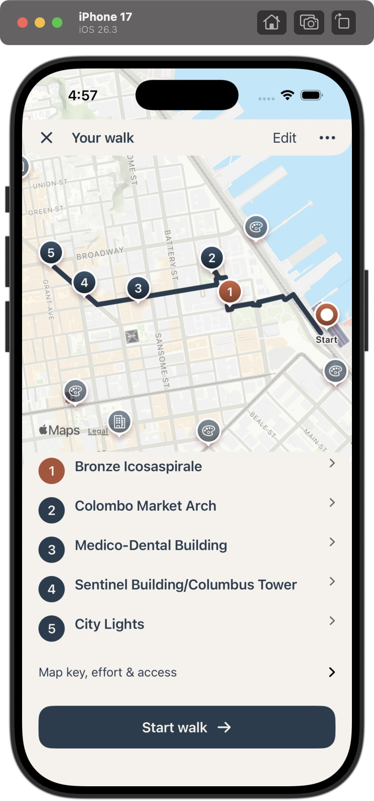
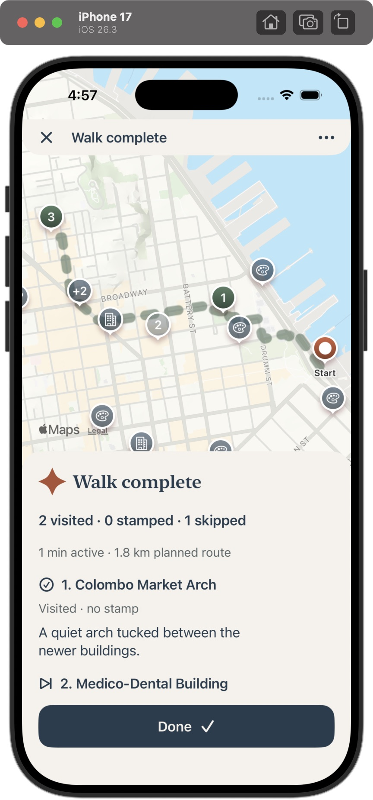

# Sidewalk

A native iPhone field guide to San Francisco. Find a place, take a walking tour, and keep notes, photos and visit stamps along the way.

  
  

## Run

Open [ios/Sidewalk.xcodeproj](ios/Sidewalk.xcodeproj) in Xcode, choose an iPhone simulator, and run. For a phone, select your signing team. Requires iOS 17+.

## Develop

Native SwiftUI + MapKit. Source is grouped by feature in [ios/Sidewalk](ios/Sidewalk); see the [code guide](docs/CODEBASE.md) for structure and commands.

- [Roadmap](BACKLOG.md) · [Data-source research](docs/DATA-SOURCE-ROADMAP.md)
- [iOS setup and tests](ios/README.md) · [Contribution rules](CONTRIBUTING.md)
- [Earlier web prototype](docs/WEB-PROTOTYPE.md)

Development build. New routes need a connection; saved directions and personal moments stay on your device.
