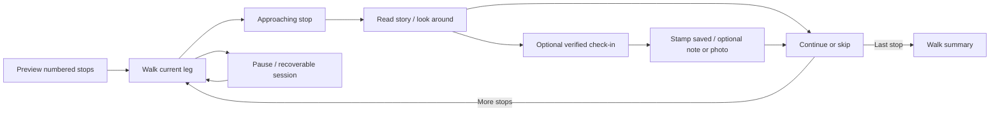

# Walking-tour UI and journey audit

Date: November 4, 2026. Native app reviewed at commit `820ebdf`.

Implementation follow-up: [Walking-tour build and verification](WALKING-TOUR-BUILD.md). The findings below describe the baseline reviewed at that commit; the follow-up records implemented behavior and remaining physical release tests.

## Assessment

Sidewalk has the beginnings of a readable walking guide, but the core tour journey is incomplete. A person can choose one destination, get a direct walking route, start foreground guidance, and attempt a check-in. There is no ordered itinerary, stop progression, recoverable tour session, or completion experience connecting those pieces.

The most urgent work is making the journey coherent and the guidance trustworthy. Further visual decoration will not resolve these gaps.

The persistent map, inline endpoint editing, readable stories without arrival gating, independent bookmarks, and separate storage of photos are useful foundations. Preserve them.

## Evidence and limits

- Rebuilt and installed the current native app in iPhone 17 Simulator. Ran the existing suite: **17 tests passed, 0 failures**. Test result: `/tmp/sidewalk-ios-build/Logs/Test/Test-Sidewalk-2026.11.04_19-57-37--0800.xcresult`.
- Interacted with Explore → Paper Doll Bar detail → Walk here → typed Ferry Building start → 27-minute / 1.8-km preview → Go → check-in → location-denied recovery → return/edit.
- Changed the destination through typed search to City Lights, selected the Apple result, generated a 21-minute / 1.4-km route, and entered walking mode. The action changed to **Finish walk**, despite City Lights existing in the curated catalog.
- Exercised Finish walk: it immediately returns to Explore, with no result or summary.
- Checked walking mode at four and eight preferred-text-size increments. At eight increments, the location-error header and destination panel occupy almost the entire screen. Restored all eight increments afterward.
- Examined route selection, route progress, map camera behavior, check-in verification, photo/note editing, persistence, and collection code.
- Ran a standalone probe using the actual `WalkingPath` definition. At a repeated intersection, it returned first-pass progress of **111 m** when second-pass progress was **286 m**. Also evaluated the current maneuver-selection predicate: with maneuvers at 100 m and 200 m, the instruction switches to 200 m when the walker is at 89 m.
- Simulator location was already denied. No permission was granted, no physical location was uploaded, and no visit was falsely collected for this audit. Successful GPS arrival, actual walking, heading accuracy, battery consumption, and full VoiceOver operation remain unverified.
- Application code was not changed by this audit. The tests establish the existing test suite's health, not navigation readiness.

Evidence files are under `/Users/kevingreco/Documents/Codex/2026-10-04/can-x20/outputs/walking-tour-audit/`:

| Evidence | File |
|---|---|
| Direct route preview | `01-route-preview.png` |
| Walking with location off | `02-walking-location-off.png` |
| Check-in permission recovery | `03-check-in-denied.png` |
| Search destination loses check-in | `04-search-loses-check-in.png` |
| Larger text walking view | `05-large-text-navigation.png` |
| Largest text obscures map | `06-maximum-text-map-obscured.png` |
| Algorithm probes | `probes.swift`, `probe-results.txt` |

## Journey review

| Stage | What the walker needs to know | Current result | Priority |
|---|---|---|---|
| Choose a walk | What will I see, in what order, and how much walking is involved? | One destination and a direct-route estimate; no stop list or tour preview | P1 |
| Start | Am I at the start, and which way do I go first? | Go starts location acquisition; typed origin can differ from current position without an explicit join-route experience | P1 |
| Walk | What do I do now, and what place comes next? | A single instruction, generic walking glyph, destination name; no current/next maneuver handoff or stop sequence | P1 |
| Get interrupted | Can I pocket the phone, check another app, or resume later? | Backgrounding stops updates; Back destroys the route; no persistent session | P1 |
| Approach | What should I look for, and can I stop here? | No approach state, entrance cue, or connection from a map discovery to the active itinerary | P1 |
| Arrive | Did I arrive, and what happens now? | Arrival text can change, but check-in remains a separate flow; no automatic stop handoff | P1 |
| Collect | Is my visit saved, and are notes/photos optional? | Stamp verification and saving a note are separate commits, without a clear success-and-continue outcome | P1 |
| Continue | Can I skip, reorder, or walk to the next stop? | No itinerary or next-stop action | P1 |
| Finish | What did I visit, and where can I find this walk later? | Generic destination closes to Explore; curated destination has no explicit finish control | P1 |

P1 means fix before presenting this as a complete walking tour. P2 means a material improvement after the core journey is dependable. No P0 is assigned without evidence of an immediate critical failure.

## Findings

### W01 · P1 · There is no tour entity or ordered stop sequence

**Evidence:** `SidewalkApp.swift:12`, `RoutePlannerModel.swift:33`, and `AppleWalkingService.route` at `RoutePlannerModel.swift:18`. A walk request carries one optional destination; the planner stores one origin, one destination and one route. No stop list, active stop index, skipped-stop state or visited-stop progression exists.

**Impact:** “Next place” suggests a sequence that the app cannot provide. The original three-to-five-stop discovery experience is absent. A walker cannot understand what the route includes or move through it.

**Change:** Introduce a tour session with ordered stop identities, walking legs, current stop, collected/skipped status, and a final destination. Preview numbered stops and total walking time/distance before Go. Keep single-place Walk here as a valid one-stop tour.

**Acceptance:** A three-stop walk previews 1/2/3, guides the first leg, supports skipping a stop, and continues to the next leg without reentering the origin.

### W02 · P1 · Discovery markers look like included stops but are unrelated to the route

**Evidence:** `ExploreView.swift:35` passes all current Explore matches to the walking map. `PlacesMap.swift:84`–`90` uses category icons and numbers for cluster counts, while the actual route contains only two endpoints. The selected destination flag is generically labeled Destination. Selected discovery pins are immediately deselected at `PlacesMap.swift:96`.

**Impact:** A bubble marked 2 can be mistaken for stop two. Restoring all markers solved disappearance, but it did not make the route visit those places. Hidden pin titles and identical styling make it hard to tell included, optional, collected and selected places apart.

**Change:** Give itinerary stops stable numbered markers, keep the active stop visually distinct, and use quieter category markers for optional nearby discoveries. Opening an optional marker should offer Add to walk, Save, or View story. Replacing the destination should be explicit and preserve the current session until confirmed.

**Acceptance:** The same stop number appears in the preview, pin, walking card and arrival card. Adding a marker creates a routed leg through it. Cluster counts cannot be confused with stop order.

### W03 · P1 · Searching for a curated place loses its collection identity

**Evidence:** Reproduced with City Lights. Nonempty queries in `LocationSearch.swift:29` pass `nil` for the curated place. `RoutePlannerModel.swift:65` stores that nil, and `WalkPlanner.swift:127` uses the presence of `model.place` to choose check-in versus closing the walk. Swapping endpoints also unconditionally clears place identity at `RoutePlannerModel.swift:71`.

**Impact:** The same physical destination behaves differently depending on how it was selected. A walker reaches a known landmark but cannot collect it from the active walk.

**Change:** Preserve curated place IDs across search, editing, rerouting and endpoint swaps. Show matching catalog results alongside Apple results; reconcile external results conservatively using identity/address and proximity, rather than silently matching arbitrary nearby points.

**Acceptance:** City Lights selected from Explore, Saved, typed suggestions, and a map marker yields the same destination identity and visit action.

### W04 · P1 · Turn instructions advance before the walker makes the turn

**Evidence:** `WalkNavigation.swift:98` selects the first maneuver whose position exceeds `progress + 12`. For maneuvers at 100 m and 200 m, the 100-m instruction disappears at 89 m, eleven metres before the turn. The same mechanism skips a maneuver starting at the route origin. The icon at `WalkNavigation.swift:116` is always a walking person until arrival.

**Impact:** Near the junction, the app can show the following instruction while the current turn is still ahead. The generic icon offers no quick visual indication of left/right/straight.

**Change:** Track the current maneuver explicitly. Keep it visible through approach and execution, then advance after reliable passage with hysteresis. Distinguish the current action from a quieter upcoming instruction and show a meaningful direction cue. Do not rely on parsing English instructions as a universal maneuver model.

**Acceptance:** Tests cover 30/12/5 m before, at, and after each turn, including route origin, backtracking, noisy fixes and closely spaced maneuvers. No pending turn vanishes early.

### W05 · P1 · Position matching can jump to an earlier or later route segment

**Evidence:** `WalkingPath.project`, `WalkNavigation.swift:10`, chooses the globally nearest segment with no previous progress, course, or movement history. Actual source probe: a repeated intersection projects to 111 m on the first pass instead of 286 m on the second.

**Impact:** Loops, switchbacks and paths that double back can show incorrect remaining distance, ETA, and maneuver. GPS jitter can also make progress jump between parallel portions.

**Change:** Match location against a plausible local range of route progress, using recent movement and uncertainty. Handle deliberate backtracking and reacquisition as separate states. Preserve uncertainty when multiple segments remain plausible.

**Acceptance:** Repeated intersections, out-and-back legs, parallel streets, stairs, backtracking and a large GPS jump do not silently skip or rewind the itinerary.

### W06 · P1 · A walk cannot be paused, resumed or safely exited

**Evidence:** Back closes immediately at `WalkPlanner.swift:25`; the parent clears route/request at `ExploreView.swift:39`. Session state exists only in view state. `WalkPlanner.swift:103` stops location in the background; no background navigation configuration, persisted session, or explicit paused UI exists.

**Impact:** Back, a relaunch, or process termination loses the walk. Locking the phone or using the camera interrupts guidance without a durable explanation. Returning from background reacquires GPS and clears progress during restart.

**Change:** Persist the itinerary and completion state separately from GPS. Provide Pause, Resume and End walk. Protect a destructive exit. Explicitly communicate foreground-only behavior until background guidance is implemented and field-tested; do not solve it by silently preventing screen lock.

**Acceptance:** Background/foreground, phone lock, camera interruption, relaunch and accidental Back preserve a recoverable walk. Resume reacquires location without marking stops as completed or losing notes.

### W07 · P1 · Location failure creates a navigation dead end

**Evidence:** In the simulator, Go showed Location needed, removed remaining distance/time, disabled Follow my location, and offered only Edit and I’m here/Finish walk. No Settings action, route-step list, or usable alternate navigation control is rendered. `clearProgress` at `WalkNavigation.swift:102` clears all progress. `openInMaps` exists at `RoutePlannerModel.swift:111` but is no longer used by the UI.

**Impact:** A person can start successfully with a typed address, then encounter an unhelpful active screen. Permission denial, temporary GPS loss and reduced accuracy all receive insufficiently differentiated recovery.

**Change:** Keep the route and readable steps available, label any retained progress as last known, explain the specific condition, and offer a relevant recovery action. Distinguish denied/restricted permission, reduced accuracy, acquiring a fix, temporary loss and paused guidance. A Settings action is useful for denial; it does not fix restricted permission.

**Acceptance:** Each failure state has one actionable recovery and preserves tour context. Offline/GPS failure never invents live progress or falsely completes a visit.

### W08 · P1 · “Update route from here” exits navigation during recovery

**Evidence:** `WalkPlanner.swift:73` calls `model.choose` then `startPlanning`; choosing invalidates the route and sets `active=false` at `RoutePlannerModel.swift:74`. There is no retained active leg or automatic navigation continuation after success.

**Impact:** An off-route walker unexpectedly returns to planning, must wait, then press Go again. If the request fails, the old route has already been discarded.

**Change:** Recalculate the current leg transactionally while preserving the current tour and a recoverable previous route. Show Updating route and resume guidance on success. Support retry or returning to the retained route on failure.

**Acceptance:** Off-route → update → success stays in walking mode and keeps the same stop identity. A failed request leaves a readable route and retry action.

### W09 · P1 · Arrival, verification and the next action are disconnected

**Evidence:** Navigation declares arrival within 40 m with uncertainty within 65 m (`WalkNavigation.swift:86`); check-in independently accepts up to 75 m with uncertainty within 100 m (`VisitLocation.swift:44`). Arrival changes text but not the primary-action logic. I’m here opens a sheet; Check in requests a second fix. There is no arrival handoff, approach card or next-stop transition.

**Impact:** A person can be allowed to check in while navigation still says they are walking. The walker taps an arrival assertion and then a second verification button, without knowing what has been achieved.

**Change:** Model approaching, nearby, verifying, collected and continuing explicitly. Explain that proximity and a verified stamp are distinct where necessary. Reuse a suitable fresh location observation, retain strict verification, and give one clear action at each state. Do not automatically open a large modal while the person is moving.

**Acceptance:** Approach cues lead to a compact arrival card; one deliberate action collects the stop, success is visible, and Continue leads to the next leg. Reading the story remains available without collection.

### W10 · P1 · Check-in gives up on the first weak fix

**Evidence:** `VisitLocation.swift:25` requests one fix. A stale or >35-m-accuracy result immediately finishes the attempt at line 40. The 20-second timeout begins before the permission interaction. A transient location error also ends verification immediately.

**Impact:** People outdoors among tall buildings may repeatedly tap a button that fails before GPS has time to settle. Waiting on the permission sheet consumes the timeout, while the recovery text can incorrectly imply the user simply needs to move outdoors.

**Change:** Give acquisition a bounded opportunity to improve, handle transient failures, and show whether the app is locating, checking accuracy or checking distance. Start acquisition timeout after authorization where appropriate. Offer an unverified personal note when verification is unavailable, without granting a verified stamp.

**Acceptance:** A weak fix followed by a precise fix can succeed within one attempt; permanent denial, timeout and genuinely distant fixes have distinct, actionable outcomes.

### W11 · P1 · Completing a visit does not complete or continue the walk

**Evidence:** Successful verification adds a place ID to `unlocked` (`FieldGuide.swift:64`); saving a note calls `collect` and merely dismisses the editor (`WalkPlanner.swift:155`). The navigation action remains I’m here. For generic destinations, Finish walk simply invokes `close()` (`WalkPlanner.swift:127`), which was reproduced in Simulator.

**Impact:** There is no clear successful ending. A curated destination can trap the person in a loop of opening the same check-in sheet; generic destinations disappear without a record or acknowledgement.

**Change:** After collection, show a compact saved state with optional Add note/photo and a prominent Continue or Finish walk. Finish should preserve a summary: visited/skipped stops, walking time/distance, saved moments and a return to Explore.

**Acceptance:** Both one-stop and multi-stop tours have an explicit terminal state. Finishing never requires guessing that the Back button ends the walk.

### W12 · P1 · Large text makes the walking map unusable

**Evidence:** At eight preferred-text increments, the location-failure header and destination/footer panels cover almost the full screen (`06-maximum-text-map-obscured.png`). `WalkPlanner` places both unbounded panels in a VStack. Meanwhile `ExploreView.swift:35` hardcodes a 220-pt map bottom inset for every planning/walking state; `PlacesMap.swift:34` hardcodes its top margin. At four increments, destination text at the left edge was clipped in the route view.

**Impact:** Text remains readable but the spatial context nearly disappears. Route fitting and following cannot reliably account for actual panel sizes, especially with long instructions or errors.

**Change:** Measure visible map occlusion and fit the camera to the available region. Provide an accessible layout that can prioritize either instructions or map without shrinking text. Move lengthy explanations behind an expandable status row and keep current-action essentials concise.

**Acceptance:** At maximum Dynamic Type, a person can access both the map and instruction content, with controls reachable and endpoints/current position framed when appropriate. Include long place names, permission errors, landscape and smaller devices.

### W13 · P2 · Walking demands too much visual attention

**Evidence:** The current direction cue is a walking glyph; the current stop has no thumbnail, stop number, entrance cue or Look for instruction. There is no approach haptic or accessibility announcement for maneuver/arrival changes. Stories are long continuous paragraphs in both detail and check-in.

**Impact:** The person needs to read the screen to interpret each state and may still not recognize the place on arrival. Paper Doll Bar's story is useful history but its Architecture category provides an awkward frame for an LGBTQ cultural stop.

**Change:** Use a clear current maneuver, stop number and concise distance. At approach, show a verified visual/entrance cue and a short place-specific observation. Offer optional restrained haptics and meaningful VoiceOver state announcements. Keep narration deferred as requested; accessibility announcements are a separate concern. Editorially review classification and short story structure rather than generating unsupported physical details.

**Acceptance:** A glance answers what to do now and what to look for. VoiceOver can identify the active stop, access an ordered itinerary, and learn of meaningful state changes without repeated GPS chatter.

### W14 · P2 · Collection and field-note state have unclear semantics

**Evidence:** The collection count uses `unlocked`, while date/note/photo live in a separate `visits` dictionary. There is one visit per place; `FieldGuide.swift:68` preserves its original date when edited. Once collected, another visit does not require re-verification. The note editor uses Cancel and permits sheet dismissal without a dirty-state guard. Photos are selected from the library; there is no camera or remove-photo control. Photo loading tasks are not associated with the latest selection.

**Impact:** Collected can mean verified without a dated visit record. Returning later edits the first visit rather than recording a new walk. Notes/photos can be dismissed silently, and rapidly choosing photos can allow an earlier load to overwrite a later choice.

**Change:** Separate a place's lifetime collection status from dated visits and tour stops. Make a note/photo optional after the stamp, show Saved feedback, preserve a draft or confirm discarding changes, support removal/replacement and camera capture, and cancel superseded photo work.

**Acceptance:** Collect without a note, add a note later, revisit on another day, cancel a dirty editor, and rapidly replace a photo all produce predictable records.

### W15 · P2 · Route effort and arrival data are insufficient for choosing a tour

**Evidence:** Preview shows only walking time and distance. The native Place type contains a point/address but no reviewed pedestrian entrance, access hours, stair information or accessibility attributes. The direct route request supplies one source and destination. No walking-time budget or intermediate scenic selection is represented.

**Impact:** A San Francisco walk may look short while involving steep hills, stairs or a place that is not accessible at that time. A coordinate is not sufficient evidence of the right public entrance.

**Change:** Add reviewed access/entrance information and disclose unknowns. Offer practical route preferences only when supported by routing/data. Clearly distinguish estimated walking time from time spent at stops; add optional extra-time/distance budgets to tour creation.

**Acceptance:** The preview explains stop count, walking effort and relevant known access constraints. Unknown step-free access is never presented as verified accessible.

## Recommended journey

### Preview

Keep the existing map. Show an ordered stop list, matching numbered pins, total walking time/distance and the final destination. A single Start walk action leads into the first leg. Editing start/destination remains inline. Explicitly include or exclude suggested discoveries in the itinerary; avoid implying every nearby pin is visited.

### Walking

Use a compact instruction surface: directional cue, current action and distance. The lower card shows Stop 2 of 4, the next place, distance/time and a collapsible itinerary. Keep map overview/follow modes distinct and offer a stateful recenter control. A secondary menu contains Pause and End walk. Recovery messages have a useful action and preserve the itinerary.

### At a stop

Use a gentle approach cue, then a compact arrival card. A person can read the story or continue without checking in. Check in earns the stamp; it should not be followed by a second required save to make the visit feel real. Notes/photos are optional, and successfully saving them returns to a clear Continue action.

### Finish

Show what was visited, skipped and collected, along with saved moments. Preserve the walk as a session rather than requiring the collection library to reconstruct it from individual places. Return to Explore through an explicit Done action.

## Implementation order

1. **Tour/session foundation:** ordered stable place IDs, active leg/stop, skipped/visited states, pause/end/resume and persistence. Resolve W01–W03, W06 and W11 together; isolated UI fixes would keep recreating these inconsistencies.
2. **Trustworthy guidance:** maneuver progression, route matching, off-route recalculation, origin joining and location recovery. Resolve W04, W05, W07 and W08 with deterministic tests before field testing.
3. **Arrival and memory:** shared arrival semantics, bounded verification acquisition, optional personal notes and collection confirmation, then Continue/Finish. Resolve W09, W10 and W14.
4. **Walking UI and access:** measured map insets, full Dynamic Type and VoiceOver review, useful directional/approach cues and reviewed entrance/effort information. Resolve W12, W13 and W15.

## Validation required for the next build

- A complete three-to-five-stop tour, including skipping one stop, collecting one without a note, adding a photo/note to another, and finishing with an accurate summary.
- The same place chosen through Explore, search, Saved and map has identical identity and collection behavior.
- Turn boundary replay, noisy GPS, repeated intersections, parallel streets, route start far from the actual walker, wrong-way movement and intentional backtracking.
- Reroute success/failure while preserving an active session and its stop identity.
- Permission denied/restricted, reduced accuracy, weak/stale fixes, temporary failure, timeout, network loss and offline readable steps.
- Background/foreground, phone lock, camera interruption, relaunch, accidental Back and explicit End walk.
- Maximum text, small-device/landscape layouts, VoiceOver journey, Reduce Motion and input focus after sheet transitions.
- Physical street tests around tall buildings, at a verified public entrance and at more than one type of landmark. Test progress/arrival and battery behavior; simulator geometry tests cannot establish these.

## Guidance consulted

The critique uses native iOS interaction expectations, with 44-pt preferred targets, semantic text sizing and meaningful accessibility state. Apple recommends interactive maps, distinct selected elements and legible clustering; the proposed itinerary styling builds on those principles rather than removing optional discovery markers. Sources: [Apple Maps HIG](https://developer.apple.com/design/human-interface-guidelines/maps), [Apple accessibility HIG](https://developer.apple.com/design/human-interface-guidelines/accessibility), and [UI design guidance](https://developer.apple.com/design/tips/). These references support the review criteria; findings above come from Sidewalk's code, simulator observations and targeted probes.
